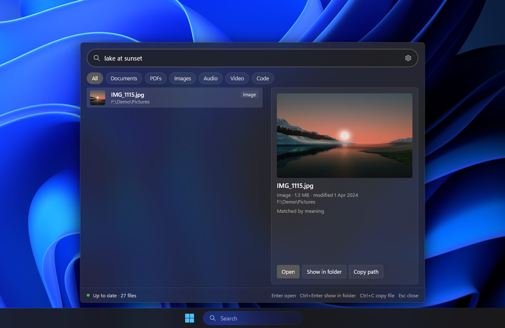
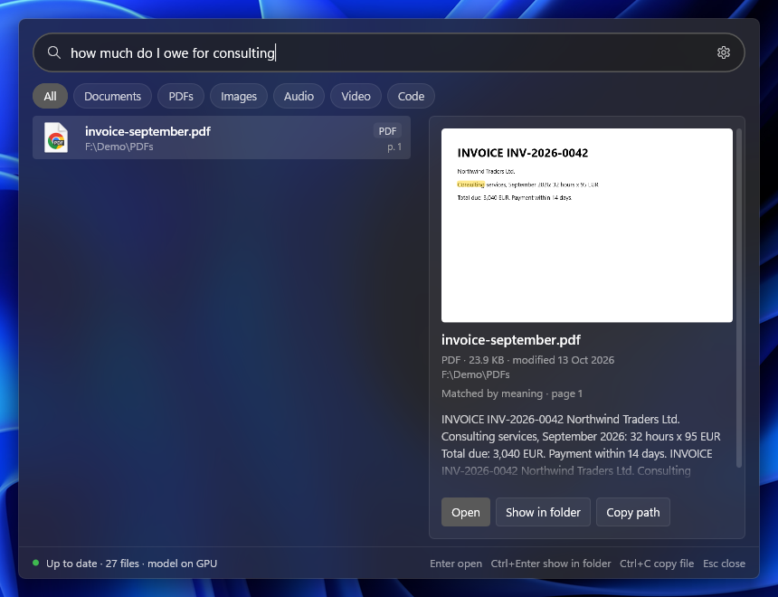
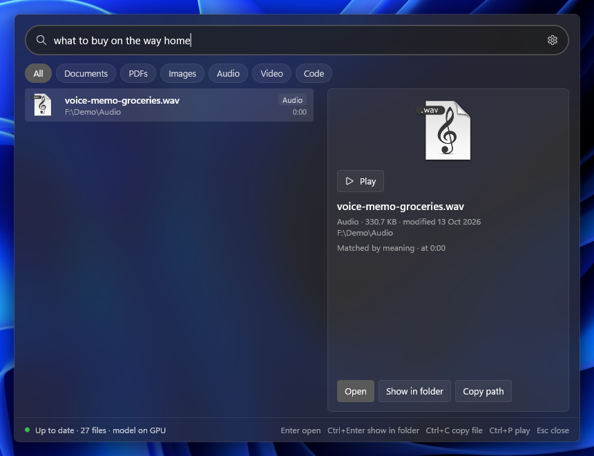
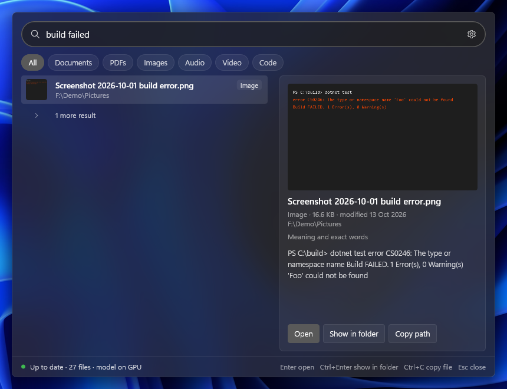
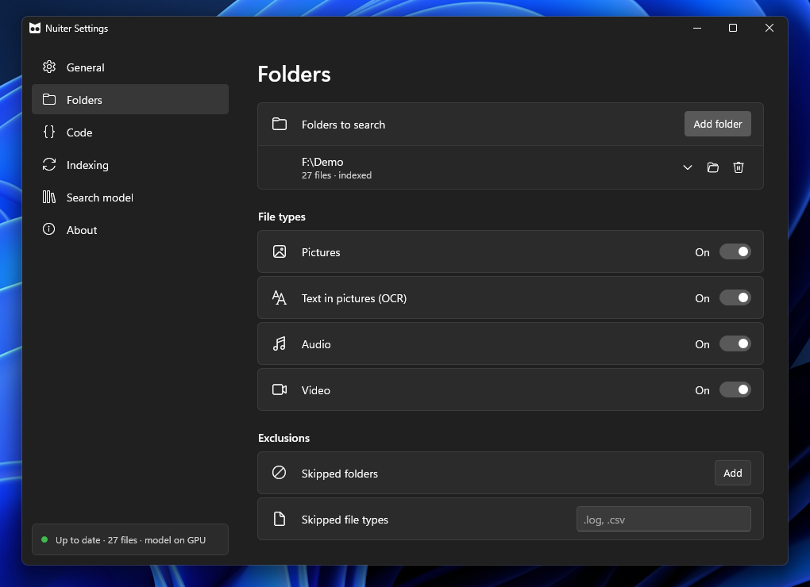

<p align="center"><picture><source media="(prefers-color-scheme: dark)" srcset="docs/icon-light.png"></picture></p>

<h1 align="center">Nuiter</h1>

<p align="center">Search your Windows PC by meaning: photos, PDFs, documents, audio, video and code.<br>
Everything stays on your PC.</p>

---

Type what you remember, in any language: *"dog on the beach"*, *"laptop receipt"*, *"voice note about groceries"*.
Nuiter finds the file even if it doesn't contain those words.

<p align="center"></p>

| A PDF by what it says | A voice note by what is said | A screenshot by its text |
|---|---|---|
|  |  |  |

<p align="center"></p>

## Install

1. Download the zip from [Releases](../../releases) and unzip it anywhere.
2. Run `Nuiter.exe` (keep the `llama` folder next to it).
3. Allow the one-time search model download (865 MB).
4. Choose the folders to search.

Requires Windows 11 x64. Uses your GPU if it has Vulkan drivers, otherwise the CPU.

## Use

Open with **Win+S**, **Win+Alt+S** or the taskbar search box.

| Key | Action |
|---|---|
| Enter | Open the file |
| Ctrl+Enter | Show in folder |
| Ctrl+P | Play audio or video from the matching moment |
| Tab | Filter by kind |

## Build

Requires Rust 1.95+ (MSVC). The bundled llama.cpp also needs Visual Studio with C++, git and the Vulkan SDK.

```powershell
powershell -File scripts/build-llama.ps1
cargo build --release
powershell -File scripts/publish.ps1   # dist/Nuiter-<version>-win-x64.zip
```

## Credits

[EmbeddingGemma 2](https://huggingface.co/google/embeddinggemma-2) by Google DeepMind,
[llama.cpp](https://github.com/ggml-org/llama.cpp), [pdf_oxide](https://crates.io/crates/pdf_oxide),
[rusqlite](https://github.com/rusqlite/rusqlite), [lewton](https://github.com/RustAudio/lewton),
[windows-rs](https://github.com/microsoft/windows-rs).

## License

MIT
