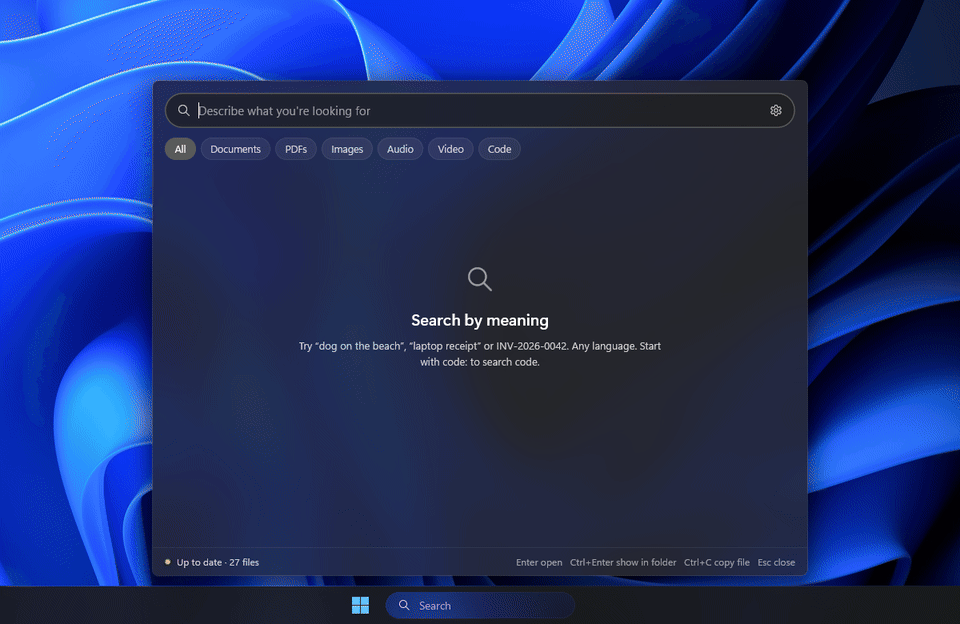

<p align="center"><picture><source media="(prefers-color-scheme: dark)" srcset="docs/icon-light.png"></picture></p>

<h1 align="center">Nuiter</h1>

<p align="center">Search your Windows PC by meaning: photos, PDFs, documents, audio, video and code.<br>
Local AI, works offline. Nothing leaves your PC.</p>

<p align="center">
<a href="../../releases/latest"></a>

<a href="LICENSE"></a>
</p>

---

Type what you remember, in any language: *"lake at sunset"*, *"how plants make sugar from light"*, *"what do I need to buy at the store"*.
Nuiter finds the photo, the PDF page, the moment in a voice note, even when the file's name and text share none of those words.

<p align="center"></p>

| A PDF by what it says | A voice note by what is said | A screenshot by its text |
|---|---|---|
|  |  |  |

## Why

Windows Search and [Everything](https://www.voidtools.com/) find files by name or by the exact words inside. Nuiter also finds them by what they
show and say: the scene in a photo, speech in a recording, a frame of a video, a page of a scanned PDF. Exact words,
invoice numbers and code identifiers still work.

- **Private**: the model runs on your PC. No account, no telemetry. The network is used for the one-time model
  download and a daily update check (can be turned off).
- **Light**: 10–20 MB of memory while idle, 25 MB download. The search model (~310 MB) is loaded while you search and
  unloaded when you don't.
- **Fast**: results appear as you type; a million vectors are scanned in ~50 ms. Indexing uses the GPU (Vulkan) or
  the CPU.
- **Many formats**: photos (JPEG, PNG, HEIC, WebP, RAW…), PDFs, Word, Excel, PowerPoint, OpenDocument, EPUB, email
  (.eml, .msg), text, audio (MP3, WAV, M4A, FLAC, Ogg…), video (MP4, MOV, MKV…), and code (60+ file types).

<p align="center"></p>

## Install

1. Download the zip from [Releases](../../releases/latest) and unzip it anywhere.
2. Run `Nuiter.exe` (keep the `llama` folder next to it). The app isn't code-signed yet: if Windows shows
   "Windows protected your PC", click **More info → Run anyway**.
3. Allow the one-time search model download (865 MB).
4. Choose the folders to search.

Requires Windows 11 x64. Uses your GPU if it has Vulkan drivers, otherwise the CPU.

## How it works

Every file becomes vectors from one model,
[EmbeddingGemma 2](https://huggingface.co/google/embeddinggemma-2), which places text, pictures and sound in the same
space: a query lands near the photo, page or audio clip that matches it. The model runs in a bundled
[llama.cpp](https://github.com/ggml-org/llama.cpp) server; files are read in separate helper processes, so a broken
file can't take the app down. Results combine meaning with keyword search (SQLite FTS5), so names and numbers
match exactly. The index is one SQLite file on your PC.

## Use

Open with **Win+S**, **Win+Alt+S** or the taskbar search box.

| Key | Action |
|---|---|
| Enter | Open the file |
| Ctrl+Enter | Show in folder |
| Ctrl+P | Play audio or video from the matching moment |
| Tab | Filter by kind |

## Build

Requires Rust 1.95+ (MSVC). The bundled llama.cpp also needs Visual Studio with C++, git and the Vulkan SDK.

```powershell
powershell -File scripts/build-llama.ps1
cargo build --release
powershell -File scripts/publish.ps1   # dist/Nuiter-<version>-win-x64.zip
```

## Credits

[EmbeddingGemma 2](https://huggingface.co/google/embeddinggemma-2) by Google DeepMind,
[llama.cpp](https://github.com/ggml-org/llama.cpp), [pdf_oxide](https://crates.io/crates/pdf_oxide),
[rusqlite](https://github.com/rusqlite/rusqlite), [lewton](https://github.com/RustAudio/lewton),
[windows-rs](https://github.com/microsoft/windows-rs).

## License

MIT
